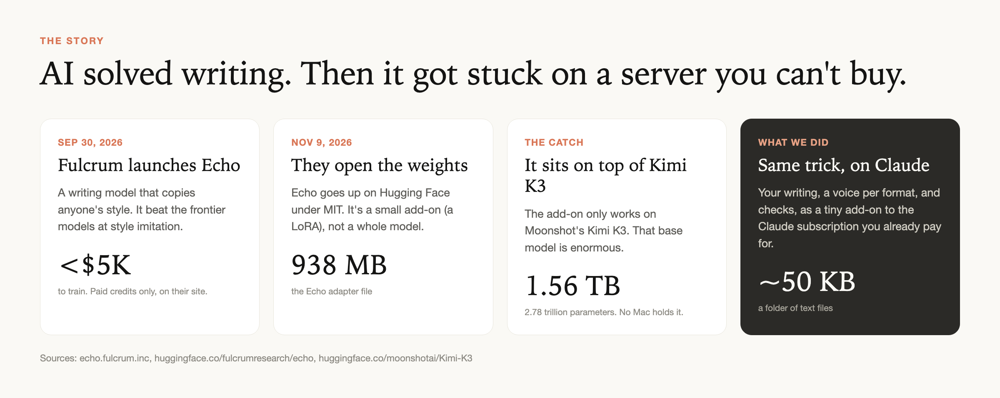
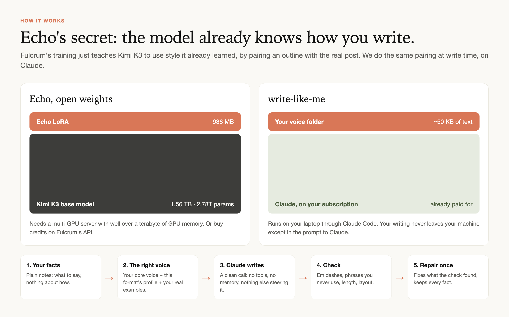
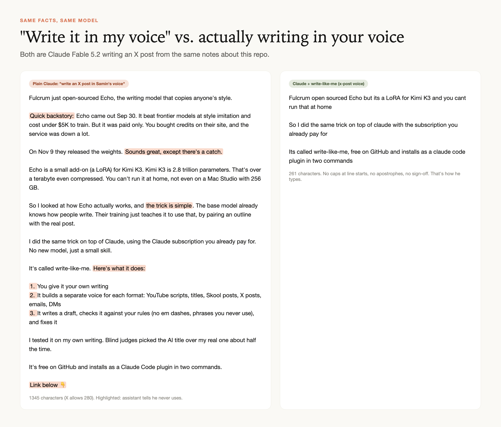
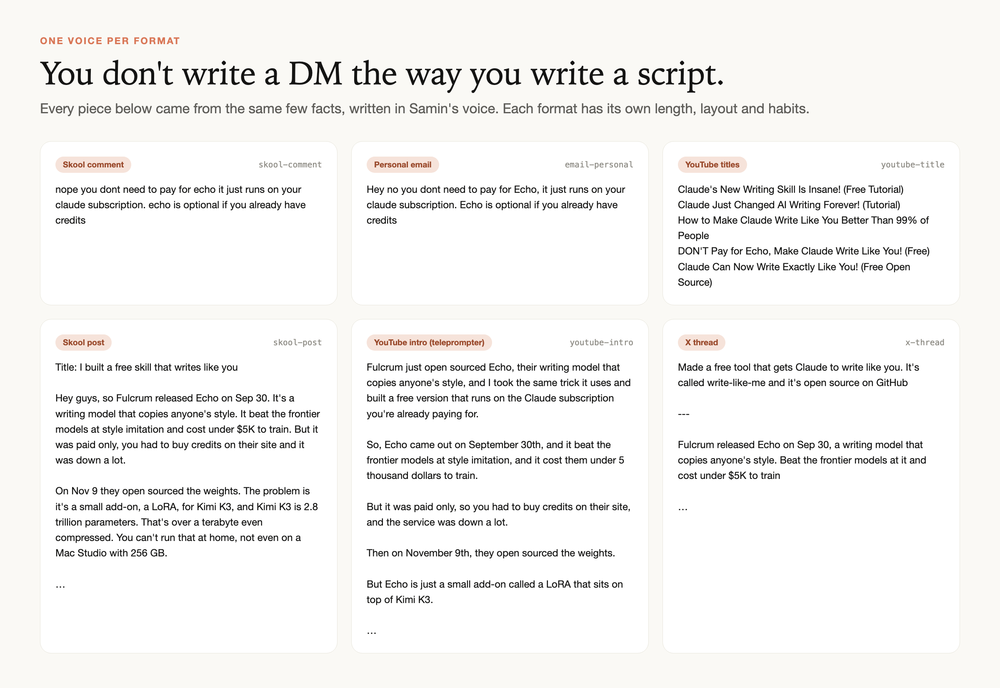
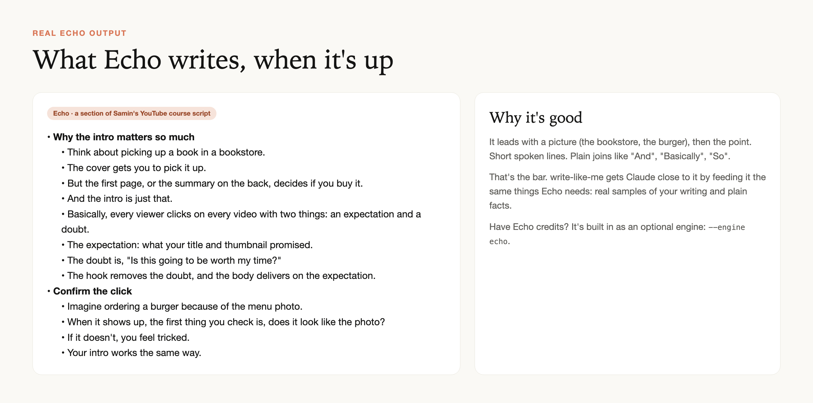
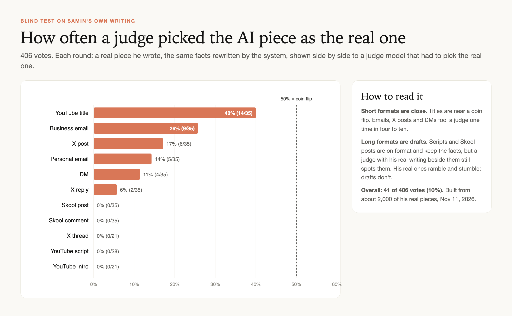

# write-like-me

**Claude writes like you.** One tested voice for each thing you write: YouTube scripts, titles, Skool posts, X posts, emails, DMs. It's the trick behind Fulcrum's Echo model, done as a tiny add-on to the Claude subscription you already pay for.



```text
/plugin marketplace add Samin12/write-like-me
/plugin install write-like-me@write-like-me
```

Then type `/write-like-me:setup` in Claude Code and it walks you through the rest.

---

## The story: AI solved writing

For years, every AI wrote the same way. You'd ask for a post "in my voice" and get the same polished assistant voice with your name on it. You know the one: "Here's the thing." "Quick backstory." A numbered list. "Link below 👇".

**Sep 30, 2026.** A small lab called [Fulcrum](https://fulcrum.inc) released [Echo](https://echo.fulcrum.inc), a model built for one job: write like a specific person. It beat the frontier models at style imitation, and it cost them under $5K to train. The catch was that it was paid only. You bought credits on their site, and the service was down a lot.

**Nov 9, 2026.** Fulcrum open-sourced it. [The weights are on Hugging Face](https://huggingface.co/fulcrumresearch/echo) under the MIT license.

**The catch.** Echo isn't a whole model. It's a 938 MB add-on (a LoRA) that only works on top of Moonshot's [Kimi K3](https://huggingface.co/moonshotai/Kimi-K3). Kimi K3 is 2.78 trillion parameters, a 1.56 TB download. Even a Mac Studio with 256 GB of memory can't hold it. Running it means renting a multi-GPU server for tens of dollars an hour. So the weights are free, but almost nobody can use them.

**What we did.** Fulcrum explained how Echo works, and the key line is this: the base model *already knows* how people write. Their training doesn't teach it anything new. It teaches the model to use what it already knows, by showing it an outline paired with the real post the person wrote.

Claude already knows how people write too. So we do the same pairing at write time instead of training time: your real writing, sorted by format, plus plain notes of what to say. That's write-like-me. No new model, no GPUs, no credits. A folder of text files and one small script, on the Claude subscription you already have.

## How it works



1. **Your facts.** You (or Claude) write plain notes: what to say, nothing about how.
2. **The right voice.** It loads your core voice, the profile for this format, and your real examples of this format.
3. **Claude writes.** A clean `claude -p` call: no tools, no memory, no project files. Nothing steers it except your voice and your facts.
4. **Check.** The draft is checked against your rules: em dashes, phrases you never use, length, layout.
5. **Repair once.** If the check fails, Claude fixes those exact problems and keeps every fact.

Why a voice *per format*? Because you don't write a DM the way you write a script. Your X posts are probably 15 words and lowercase. Your YouTube intro is read word for word off a teleprompter. Your sponsor emails are 20 words with no sign-off. One "voice" for all of that is why AI writing sounds off.

## See the difference

Same facts, same model (Claude Fable 5.2), one with write-like-me and one without:



## One voice per format

Everything below came from the same handful of facts, written in my voice with my real examples:



The 14 formats it ships with:

| Format | What it is |
|---|---|
| `youtube-script` | A section of a video you read or talk from. Teleprompter layout, one idea per line. |
| `youtube-intro` | The hook and intro, read word for word. |
| `youtube-title` | Five title options in your proven patterns. |
| `youtube-description` | Your description template, chapters, only the links you name. |
| `skool-post` | A post to your community (Skool, Circle, Discord, Slack). |
| `skool-comment` | A reply to a member under a post. |
| `x-post` | A single post on X. |
| `x-reply` | A reply to someone else's post. |
| `x-thread` | A short thread, posts split with `---`. |
| `linkedin-post` | A LinkedIn post. |
| `newsletter` | A newsletter issue or section. |
| `email-business` | Sponsors, clients, vendors, partners. |
| `email-personal` | Friends, members, viewers, support desks. |
| `dm` | A direct message on any app. |

Add your own by copying any folder in `skills/write-like-me/templates/formats/` and adding a line to `formats.json`.

## What real Echo looks like

This is real Echo output, a section of my YouTube course script, written when the service was up. It's the bar we're aiming for:



If you have Echo credits, it's built in as an optional engine. See [Using Echo](#using-echo-too).

## Does it actually work?

I built my own version from about 2,000 pieces of my real writing and ran a blind test: take a real piece I wrote, turn it into neutral notes, let the system write a new piece from those notes, then ask a judge model to pick which one is mine.



Honest read:

- **Short formats are close.** Titles are near a coin flip. Emails, X posts and DMs fool a judge one time in four to ten.
- **Long formats are good drafts, not ghost-writing.** Scripts and Skool posts keep the facts and the format, but a judge with my real writing beside them still spots them. Real writing rambles and stumbles. Drafts don't.
- **More real examples = better voice.** Formats where I had little real writing (I haven't hand-written an X thread in two years) were the weakest.

You can run the same test on your own voice with `/write-like-me:test`.

## Use it

You need [Claude Code](https://claude.com/claude-code) logged in with your Claude subscription, and Python 3 (already on every Mac).

### 1. Install

In Claude Code:

```text
/plugin marketplace add Samin12/write-like-me
/plugin install write-like-me@write-like-me
```

Or from your terminal: `claude plugin marketplace add Samin12/write-like-me && claude plugin install write-like-me@write-like-me`.

### 2. Set up your voice (about 20 minutes)

```text
/write-like-me:setup
```

Claude asks your name and which formats you write, then helps you collect your real writing for each one: YouTube transcripts, your X archive, Skool posts, sent emails. It writes your examples, your core voice and a profile for each format into `~/.write-like-me/`, then blind-tests each format and shows you the scores.

The one rule: **only your own words.** Anything written by AI, an assistant or a ghostwriter teaches it the wrong voice. Keep your typos. They're part of how you sound.

Step-by-step, with where to find your writing on each platform: **[docs/GUIDE.md](docs/GUIDE.md)**.

### 3. Write

Just ask, the skill kicks in on its own:

```text
write a skool post announcing my new video on Claude Code hooks, link is youtu.be/xyz
reply to this sponsor email saying my rate is $4k for a 60s integration
give me 5 titles for a video about building an AI trader
```

Or use `/write-like-me:write <what you want>`. You get a draft, which format and engine wrote it, and the check result. It never posts or sends anything.

### 4. Make it better over time

When you edit a draft, tell Claude "learn from my edit". It saves the before and after into that format's profile. New things you write yourself go into `examples.md`. Re-run `/write-like-me:test` after big changes.

### No Claude Code? (claude.ai or Claude desktop)

Set up your voice once in Claude Code, then ask it to "pack my voice for claude.ai" (or run `$WLM pack`). That makes `write-like-me-skill.zip` on your Desktop with your voice folder inside. Upload it in Claude under Settings → Capabilities → Skills. There's no `claude` command in that sandbox, so the skill uses `wlm.py brief`: it builds the same prompt and Claude writes from it directly. Same voice, one less clean-room step. Re-pack after you improve your voice.

### The command line

Everything the skill does is one script, so you can run it yourself:

```bash
WLM="python3 ~/.claude/plugins/marketplaces/write-like-me/skills/write-like-me/scripts/wlm.py"
$WLM init --name "Your Name"                  # make ~/.write-like-me
$WLM formats                                  # formats and how many examples each has
$WLM write x-post --facts notes.md            # write, check, repair once
$WLM check email-business draft.md            # lint a draft (exit 1 on errors)
$WLM brief skool-post --facts notes.md        # print the full prompt for any chat app
$WLM test youtube-title --rounds 3            # blind test
$WLM doctor                                   # what works on this machine
$WLM pack                                     # zip the skill + your voice for claude.ai
```

`notes.md` is plain bullets. First line can be `task: reply, about 20 words`. For a reply, add `- Situation: what they said`.

The writer defaults to Claude Fable 5.2 and falls back to Opus. Change `model` in `~/.write-like-me/config.json`.

## Using Echo too

If you have Echo credits from [echo.fulcrum.inc](https://echo.fulcrum.inc), set your key in your own shell (never in a file in this repo) and pick the engine:

```bash
export ECHO_API_KEY=...
$WLM write youtube-script --facts notes.md --engine echo
```

It sends the same examples and facts to Echo instead of Claude. Echo is optional. Claude is the default because it's on the plan you already pay for and it's always up.

## What's in the repo

```text
.claude-plugin/             plugin + marketplace manifests
commands/                   /write-like-me:setup, :write, :test
skills/write-like-me/
  SKILL.md                  what Claude follows
  scripts/wlm.py            the whole engine (Python, standard library only)
  templates/                core voice, lint rules, 14 format profiles
docs/GUIDE.md               the step-by-step setup guide
examples/                   the example outputs shown above, as text
assets/                     the images in this README (src/ has the HTML)
```

Your voice lives in `~/.write-like-me/`, outside the repo. It's yours: plain Markdown and JSON you can read, edit, back up or put in your own private repo.

## Privacy

- Your writing stays on your machine in `~/.write-like-me/`. It's sent to Claude (or Echo, if you choose it) only as part of a writing prompt, the same as pasting it into a chat.
- Remove phone numbers, other people's emails and anything private before it goes into `examples.md`.
- Nothing here posts, sends or schedules anything. It writes drafts.

## FAQ

**Is this Echo?** No. It's Echo's idea (show the model your real writing next to an outline, and let it use what it already knows) done at write time on Claude. Not affiliated with Fulcrum.

**Can I just run the Echo weights?** Only if you can host Kimi K3: 2.78 trillion parameters, 1.56 TB. That's a multi-GPU server, not a laptop or a Mac Studio.

**Which Claude plan?** Any plan that includes Claude Code. Each draft is one short call (two if it needs a repair). Setup and blind tests use more.

**How many examples do I need?** 3 per format to test, 5 to 20 to sound right. Short formats (titles, X posts, DMs) get good fastest.

**It still sounds a bit too clean.** That's the most common gap. Add more raw examples (dictated posts, quick replies), add your edits as before/after, and add the phrases it keeps using to `lint.json`.

## Credits

Built by [Samin Yasar](https://github.com/Samin12) for the Claude Club community. The idea comes straight from Fulcrum's [Introducing Echo](https://echo.fulcrum.inc) write-up. Thanks to them for publishing how it works and opening the weights.

MIT License.
